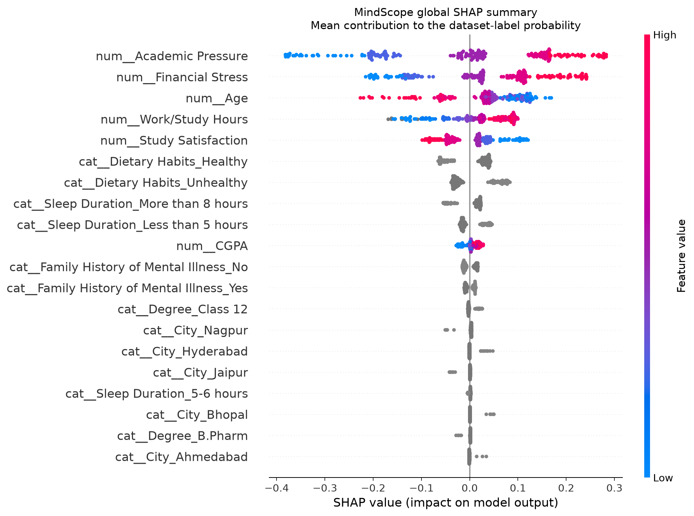
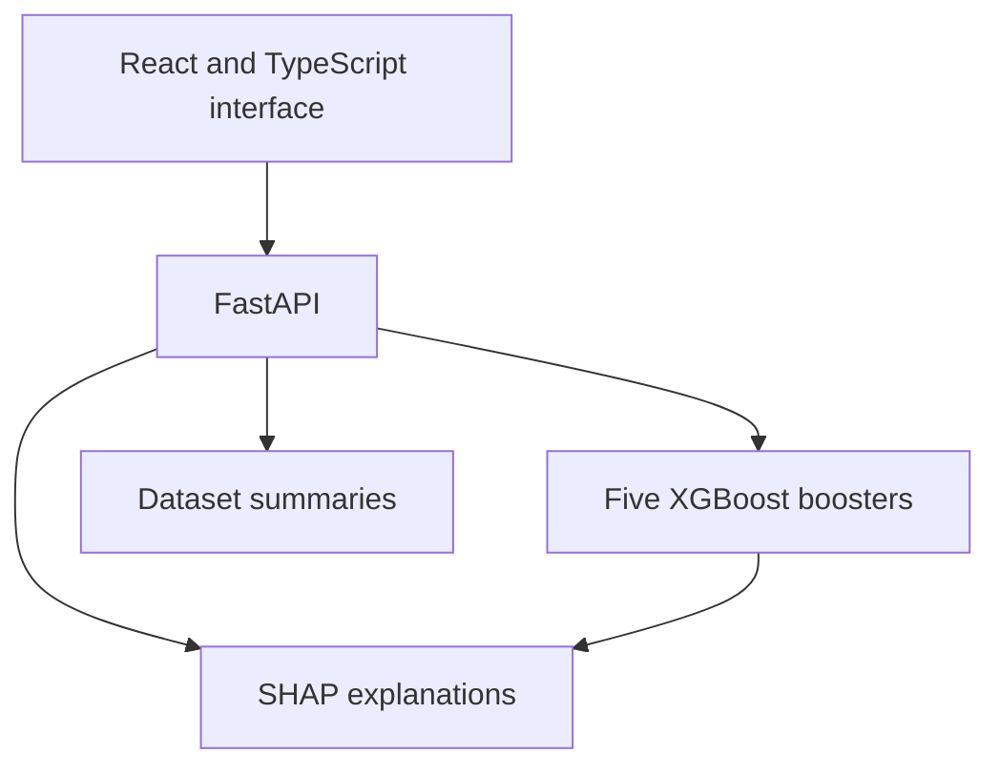

# MindScope

**An explainable machine learning application for exploring the OpenML Student Depression Dataset.**

MindScope takes a trained model from Kaggle to a browser-based research tool. Explore the dataset, run a hypothetical student profile through a five-member XGBoost ensemble, and inspect which inputs move the model’s estimated probability of the recorded **Yes** label.


[Results](#held-out-results) · [Explainability](#explainability) · [Run locally](#run-locally) · [Deployment](#deployment)

> **Research use only.** The model estimates a label recorded in a survey dataset. Its outputs are unsuitable for diagnosis, clinical screening, treatment, or decisions about individual students. Try the app with hypothetical profiles.

## What you can explore

| App section | What you’ll find |
| --- | --- |
| **Assessment** | Load a sample profile or enter 15 features. See the Yes and No probabilities, the decision at a threshold of 0.56, and an individual SHAP waterfall. |
| **Explainability** | Compare global feature contributions and inspect how selected features affect model estimates across the sampled records. |
| **Dataset** | Explore class balance, distributions, missing values, numeric summaries, and Pearson correlations. |
| **Performance** | Inspect held-out metrics, the confusion matrix, the calibration curve, and the saved prediction parity check. |
| **Overview and Methodology** | Review the project scope, preprocessing, model evaluation, and responsible-use limits. |

## Held-out results

The [OpenML dataset](https://www.openml.org/search?type=data&sort=runs&id=46874) contains **27,901 records**. Filtering to students yields **27,870 records**. The notebook used a stratified 60/20/20 split with seed 42 and selected the **0.56** threshold on validation macro-F1. The final model was refit on the **22,296** training and validation records, then scored on the original **5,574-record holdout**.

| Metric | Exported ensemble |
| --- | ---: |
| Accuracy | **79.15%** |
| Macro-F1 | **0.7857** |
| ROC-AUC | **0.8714** |
| Average precision | **0.8974** |
| Precision for Yes | 0.8251 |
| Recall for Yes | 0.8170 |
| Brier score | 0.1416 |

These are results for the model served by MindScope. The Performance page also shows the notebook’s earlier results for the train-only ensemble. Ten saved Kaggle predictions matched the serving implementation within **4.89 × 10⁻⁷** absolute probability error. [Evaluation artifact](artifacts/model_metrics.json) · [Academic report](docs/project_report.md)

## Explainability

MindScope computes TreeSHAP for each of the five boosters in probability space. It averages their contributions and groups related one-hot inputs under the original feature name. The baseline plus the signed contributions reconstructs the ensemble’s estimated Yes probability. The maximum reconstruction error across **200 sampled records** was **1.43 × 10⁻⁷**.



The chart describes how the fitted ensemble uses its inputs. Feature contributions do not establish causation or clinical significance. [Technical reference](docs/technical_reference.md)

## Architecture



The API loads the fitted preprocessing pipelines and portable booster files once at startup. It runs on CPU and serves the precomputed global SHAP results alongside on-demand individual explanations. The application has no database and does not retain submitted profiles.

## Run locally

Requires **Python 3.13** and **Node.js 22 or newer**. Clone the repository, then run the backend commands in **Git Bash** on Windows.

```bash
git clone https://github.com/AhsanCS64/MindScope.git
cd MindScope
python -m venv .venv
source .venv/Scripts/activate
python -m pip install -r backend/requirements-dev.txt
python backend/prepare_dataset.py
OMP_NUM_THREADS=1 OPENBLAS_NUM_THREADS=1 python -m uvicorn app.main:app --app-dir backend --host 127.0.0.1 --port 8000 --no-access-log
```

On macOS or Linux, activate with `source .venv/bin/activate`. If the verified CSV already exists in `data/raw/`, skip dataset preparation. To prepare it from the original local ARFF file, run `python backend/prepare_dataset.py --arff dataset_`.

Keep the backend running. In a second terminal, starting from the repository root, run the frontend.

```bash
cd frontend
npm ci
npm run dev
```

Open [MindScope](http://localhost:5173) and choose **Assessment → Load sample profile → Run model**. See [API health](http://127.0.0.1:8000/api/health) and [Swagger UI](http://127.0.0.1:8000/docs) for backend checks.

## Reproduce the evaluation

From the repository root with the virtual environment active:

```bash
cd backend
python validate_model.py
python -m pytest -q
python benchmark.py
```

The validation script checks the portable export, reconstructs the notebook split, and reproduces the holdout metrics with the fitted model. Run `python generate_global_shap.py` from `backend/` to regenerate the figure and global contribution data. To verify the frontend production build, run `npm run build` from `frontend/`.

## Deployment

The repository includes a [Render Blueprint](render.yaml) for the backend and a [Vercel configuration](frontend/vercel.json) for the frontend. Deploy Render first, use its HTTPS origin as Vercel’s `VITE_API_URL`, then set Render’s `CORS_ORIGINS` to the deployed frontend origin. [Step-by-step deployment guide](docs/deployment.md)

## Author

**H. M. Ahsan Habib Kushal (Archmage)** · Computer Science and Engineering, NITER, University of Dhaka

MindScope brings together two areas of my work: applied machine learning and full-stack software engineering. I built it to make the path from a trained model to an inspectable application visible, including the evidence behind its predictions and the limits of what they can tell us.

[GitHub](https://github.com/AhsanCS64) · [Portfolio](https://ahsanhabibkushal.vercel.app/) · [Hugging Face](https://huggingface.co/Archmage64)

