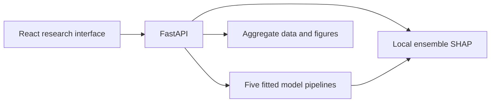

# MindScope technical reference

## System architecture

The browser sends one profile as JSON for each requested computation. The API loads the model and dataset once per worker, derives aggregate summaries, and holds the explanation background in memory. Local explanations are serialized and excess requests receive HTTP 429. The production command disables access logging. There is no accounts database, profile persistence, or prediction history service.

## API

| Method | Route | Result |
|---|---|---|
| GET | `/api/health` | Application readiness and model version |
| GET | `/api/model/info` | Ordered schema, allowed categories, numeric bounds, and threshold |
| GET | `/api/model/metrics` | Refit holdout scores, confusion matrix, calibration, notebook comparison, and prediction parity |
| GET | `/api/dataset/summary` | Cohort size, target counts, and missingness |
| GET | `/api/analytics/features` | Feature counts, numeric summaries, and distributions |
| GET | `/api/analytics/features/{name}` | Details for one public feature |
| GET | `/api/analytics/correlations` | Pearson correlations among numeric inputs |
| POST | `/api/predict` | Yes/No probabilities, label, threshold, model version, and explanation availability |
| POST | `/api/explain` | Probability-space SHAP contributions, baseline, and additivity error |
| GET | `/api/explain/global` | Sample size, grouped importances, additivity, and dependence plot paths |
| GET | `/api/explain/global/summary-plot` | Precomputed SHAP beeswarm PNG |
| GET | `/api/explain/global/dependence/{feature}` | Precomputed dependence plot PNG |

Both POST routes accept an object whose keys match `feature_columns` exactly. Fetch `/api/model/info` for allowed values. All inputs are required. Numeric fields accept finite JSON numbers within the observed cohort range. Categorical fields accept exact fitted strings. HTTP 422 indicates input validation failure, 429 indicates a busy explanation worker, and 503 covers unavailable artifacts or unverifiable explanations. Swagger UI is served at `/docs`, and the schema is available at `/openapi.json`.

## Model card

| Property | Value |
|---|---|
| Identifier | OpenML-46874-XGBoost-5-seed |
| Estimator | Five binary XGBoost boosters, 1,912 rounds each |
| Training seeds | 42, 43, 44, 45, 46 |
| Inputs | 15 features, including 7 categorical features |
| Preprocessing | Saved estimator-specific pipelines with median and most-frequent imputation and one-hot encoding |
| Output | Arithmetic mean of the five estimated Yes probabilities |
| Decision rule | Yes when the estimate is at or above the saved threshold, approximately 0.56 |
| Parity evidence | Ten saved prediction references and five refit wiring checks reproduced within tolerance |
| Performance evidence | Final refit evaluated on the original stratified 5,574-record holdout; calibration uses ten quantile bins |
| Intended use | Educational demonstrations using hypothetical profiles |

The original joblib triggered an XGBoost input-stream error in the available runtime. The verified portable export supplies the five preprocessing objects and five booster JSON files. Use only project-controlled model files because loading joblib objects can execute code. No retraining occurred during integration.

## Dataset

OpenML 46874 v2 contains 27,901 records and 17 columns. The application displays aggregates over 27,870 student records after filtering by profession and removing full-row duplicates. The release conversion verifies the source SHA-256. The CSV remains out of source control.

The target is `Depression`, encoded as No = 0 and Yes = 1. Dataset and notebook documentation do not establish a clinical reference standard for the labels. A self-harm-related source field is absent from the model inputs, form, and public analytics. The API publishes only the model inputs, aggregate results, and offline plots. [OpenML metadata](https://www.openml.org/api/v1/json/data/46874)

## SHAP methodology

MindScope computes interventional TreeSHAP in probability space against a deterministic 64-row background. It computes contributions and the baseline for every booster and takes their arithmetic means. This matches the ensemble's averaging rule. Before SHAP sees a sparse-encoded feature matrix, missing positions remain missing while stored values retain their value. This matches the booster input representation.

One-hot contributions are summed under their original feature for the local waterfall and global mean absolute importance. The beeswarm and dependence plots use transformed features. The global sample contains 200 profiles. Each explanation is checked by comparing the baseline plus contributions with the ensemble's predicted probability. The permitted absolute residual is 0.0002.

## Responsible use

The application uses a survey dataset to demonstrate model behavior. Feature effects represent shifts in the estimated label probability relative to the chosen background. The study does not demonstrate medical causality, reliable personal risk estimation, fairness across subgroups, or generalization to another campus or country. Use hypothetical inputs and avoid submitting identifiable or sensitive information. The application has no feature for retaining submitted profiles or sharing assessment results.

